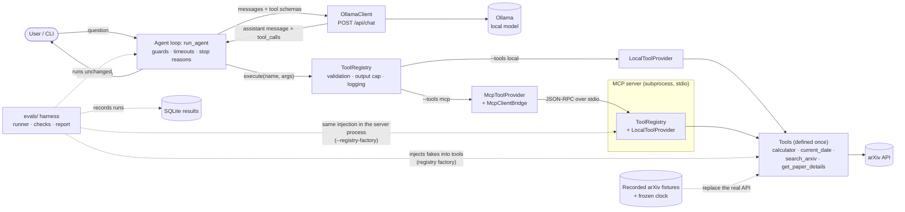

# local-research-agent

A research assistant that runs entirely on your machine. A local LLM served by [Ollama](https://ollama.com) answers questions by calling Python tools through native tool calling: a safe calculator, the current date, arXiv search and arXiv paper details. A bounded agent loop with explicit stop reasons drives it, the same tools are also served over the Model Context Protocol (MCP), and an evaluation harness measures the agent reproducibly against a mocked arXiv.

## Architecture



*Solid lines: normal execution. Dashed lines: evaluation only (mocked arXiv, frozen clock).*

See [docs/architecture.md](docs/architecture.md) for module responsibilities, the tool-calling round trip, the loop's invariants, the MCP bridge and the evaluation harness, and [docs/framing.md](docs/framing.md) for the project's scope and decisions.

## Features

- **Native tool calling** with a local Ollama model (developed against `qwen3:8b`).
- **Bounded agent loop**: iteration, per-call and total time budgets, repetition detection and a consecutive-error budget; every run ends with one explicit stop reason.
- **Tools defined once**: a name, a description, a Pydantic argument model and a function; the JSON schema, validation and the MCP listing are derived from it.
- **Errors as observations**: invalid arguments, tool failures and timeouts are returned to the model as actionable `Error: ...` messages.
- **arXiv tools** that follow the arXiv API terms of use (one request every 3 s, single connection, caching).
- **MCP server over stdio** exposing the same tools, and an MCP client mode for the agent (`--tools mcp`) with byte-identical tool schemas.
- **Evaluation harness**: an 18-case suite, a deterministic fake arXiv, pure checks, SQLite storage, Markdown reports, and batch comparison with provenance hashes (prompt, suite, tool schemas, model digest, git commit).
- **Structured JSON logs** on stderr.

## Quickstart

### Prerequisites

- Python 3.11 or later and [uv](https://docs.astral.sh/uv/).
- [Ollama](https://ollama.com) running locally, with a model that supports tool calling:

  ```bash
  ollama pull qwen3:8b
  ```

### Install

```bash
uv sync
```

### Configuration

The CLI reads these environment variables (see [.env.example](.env.example); no `.env` file is loaded automatically):

| Variable | Default |
|---|---|
| `OLLAMA_HOST` | `http://127.0.0.1:11434` |
| `OLLAMA_MODEL` | `qwen3:8b` |
| `OLLAMA_CONNECT_TIMEOUT` | `5` (seconds) |
| `OLLAMA_READ_TIMEOUT` | `300` (seconds) |
| `LOG_LEVEL` | `INFO` |

### Usage

```bash
# Arithmetic and dates
uv run local-research-agent "What is 17 * 23 + 4?"
uv run local-research-agent "How many days are there between today and 2026-12-25?"

# Research questions (real arXiv API)
uv run local-research-agent "Find 3 recent papers on graph neural networks for protein-protein interaction and summarize them."

# Same agent, tools served by an MCP server subprocess
uv run local-research-agent --tools mcp "What is 12% of 2450?"

# Other options
uv run local-research-agent --help
```

The answer and a compact trace go to stdout; JSON logs go to stderr. Exit code: 0 when the model answered, 1 for any other stop reason, 2 when the MCP server could not be started. `uv run python -m local_research_agent.cli ...` is equivalent.

## Running the tests

```bash
uv run pytest                    # unit tests: no network, no Ollama (includes local MCP subprocess tests)
uv run pytest -m "not mcp"       # skip the tests that start MCP server subprocesses
uv run pytest -m integration     # opt-in: real Ollama and/or the real arXiv API
uv run ruff check && uv run ruff format --check
```

## Running the evaluation

The harness runs the suite against the local Ollama model; arXiv is served from recorded fixtures, so no other network access is needed.

```bash
uv run python -m evals.run --suite minimal --repeat 3 --label baseline
uv run python -m evals.run --suite minimal --repeat 3 --label workflow --prompt-variant research_workflow
uv run python -m evals.run --suite minimal --repeat 3 --label mcp --tools mcp

uv run python -m evals.report --label baseline
uv run python -m evals.report --label baseline --compare workflow
```

Results are stored in `evals/results/evals.sqlite` and reports are written to `evals/results/<label>.md` (git-ignored). `--require-clean` refuses to run with uncommitted changes, so a batch can be tied to a commit. `uv run python -m evals.run --help` lists every option.

## Results

<!-- Results will be added after the evaluation matrix has been run. -->

## Design decisions

- **Native tool calling.** The model receives JSON schemas in the request's `tools` field and returns structured `tool_calls`; nothing is parsed out of free text.
- **Tools defined once.** Each tool is a name, a description, a Pydantic argument model and a function. The schema sent to the LLM, the argument validation and the MCP listing all derive from that definition, so local and MCP tools cannot drift apart.
- **Errors as observations.** The tool registry never raises: unknown tools, invalid arguments, tool exceptions and timeouts become `Error: ...` observations the model can react to. Only the loop's guardrails end a run early, always with an explicit stop reason.
- **A single agent.** One loop and one tool registry cover the use case; multiple agents would add coordination failure modes and make evaluation harder to interpret.
- **MCP over stdio.** The server runs as a subprocess speaking JSON-RPC over its pipes: no port, no authentication layer, nothing to deploy.

## Limitations

- **Small suite.** 18 cases with a few repetitions each: a one-run difference between two batches is not a meaningful signal.
- **Mocked arXiv.** The harness serves recorded fixtures by rule (any search returns the case's recorded feed), so query quality is not measured, and fixtures are a snapshot in time.
- **Heuristic checks.** Some checks are regexes over free-form wording. They are reported separately from deterministic checks, but can misjudge a valid answer.
- **Local 8B reliability.** A small local model can skip tools, stop early or summarize from snippets; behaviour varies across runs, and GPU inference is not fully deterministic even with a fixed seed.
- **Synthetic injection fixture.** The prompt-injection case uses a hand-written abstract, not a real paper.
- Tool timeouts stop waiting but cannot kill a running thread.

## Roadmap

- **LangGraph** orchestration with a **verification node** that checks the draft answer against the tool results before answering.
- **Extended evaluation**: a larger suite, more models and an evaluation matrix.
- **FastAPI** service exposing the agent over HTTP.
- **docker-compose** setup bundling the service and Ollama.